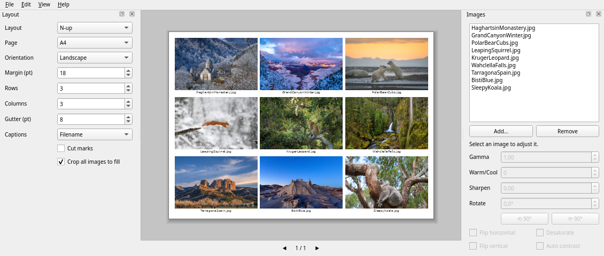
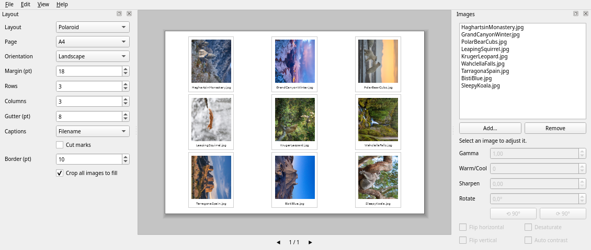
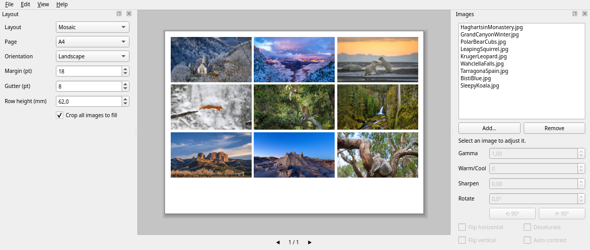
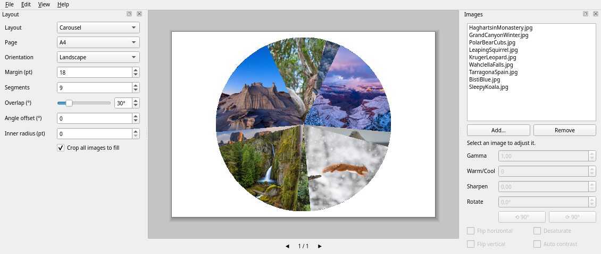

PhotoSheet
==============
[](https://pypi.org/project/photosheet/)
[](https://github.com/javadr/PhotoSheet/archive/master.zip)


[](https://github.com/javadr/PhotoSheet/network/members)
[](https://github.com/javadr/PhotoSheet/stargazers)
[](https://github.com/javadr/PhotoSheet/issues)
[](https://pepy.tech/project/photosheet)
[](https://pepy.tech/project/photosheet)


<p align="center"></p>

Put many photos on one printed sheet: passport photos, contact sheets, wallet prints, photo-booth strips,
posters and more. PhotoSheet previews the page, lets you arrange the photos with the mouse, and then
prints it or saves it as a PDF or PNG. Built with Python and Qt (PySide6).

## Screenshots

| N-up with captions | Polaroid |
|---|---|
|  |  |
| **Mosaic** | **Carousel** |
|  |  |

## Features

**Layouts**

| Layout | What it is for |
|---|---|
| **N-up** | A grid of rows × columns, 3 × 3 to start with (change it in the Layout panel). Optional contact-sheet captions (filename and/or number) and cut marks. |
| **Single** | One photo per page. |
| **Poster** | One photo tiled across several pages, with overlap. |
| **Carousel** | A circular montage with one wedge per photo. |
| **Fixed size** | Prints of one size (passport, wallet, 4 × 6, 5 × 7 …) packed to fill the page. |
| **Passport** | Copies of each photo filling a small sheet, like a photo shop: 8 passport photos in a 4 × 2 grid on a landscape 4 × 6 in. |
| **Mosaic** | Rows of mixed-shape photos, each shown whole and not cropped. |
| **Photo strip** | Booth-style strips with several frames each, outlined for cutting. Strips run sideways on a landscape page; the Direction setting can force either way. |
| **Polaroid** | Instant-photo prints: white cards with a thin border and a thick bottom edge, with optional captions. |
| **Triptych** | One photo split into 2 to 12 panels with a gap between them, side by side or stacked, on one page. |
| **Package** | Studio sheets that mix print sizes, such as one 5 × 7 plus four wallets on an 8 × 10. Prints are packed to use the sheet well. |
| **Collage** | Free-form: move and resize each photo with the mouse, with snapping guides, handles and bring-to-front. |
| **Framed print** | One photo per page on a wide white, black or cream mat, with a thin line around the picture and an optional caption. |
| **Badges** | Round photos for button badges, stickers or coasters (25 to 75 mm), staggered to fit more, with optional cut circles. |
| **Feature** | One large hero photo with a row or column of smaller photos, repeated page after page. |
| **Film strip** | 35 mm negative-style strips: black film with sprocket holes and 2:3 frames, several strips per page, vertical or horizontal (Direction setting). |
| **Bento** | Asymmetric tile grids that fill the page (hero-left, hero-top, wide, pinwheel, magazine, six tiles). |
| **Golden spiral** | Photos in a spiral, each taking about 62% of the space that is left. |
| **Honeycomb** | Hexagon-shaped photos nested like a honeycomb, with optional cut lines. |
| **Calendar** | A wall calendar: a photo above a month grid, one page per month, weekends in red. |
| **Masonry** | Pinterest-style columns: photos keep their shape and each goes into the shortest column. |
| **Shapes** | A grid of photos cropped to a heart, star, diamond, triangle, rounded square or circle. |
| **Ring** | A wreath of round photos around a circle, with a bigger photo in the middle (6 or more around the ring). |
| **Scatter** | A casual pile of tilted prints on white cards with soft shadows; the seed makes the same pile every time. |
| **Slant** | Diagonal parallelogram panels side by side, each photo cut to its slanted shape; lean left or right. |
| **Fan** | Cards fanned out like a hand of playing cards, the last on top. Suits landscape paper best. |
| **Brick** | Brickwork that fills the page edge to edge: every other row is shifted half a tile and starts and ends with a half-width photo. Starts at 5 × 5 on landscape paper (change the Orientation, or use `--portrait`). |
| **Timeline** | Photos alternate either side of a line, each with its date from the photo's own data. Use Edit ▸ Sort Photos by Date to put them in order. |
| **Checker** | A chessboard: photos on every other square, the rest filled with a pale tint. Rows, columns and gutter are set in the Layout panel; tick *First cell empty* to start the pattern on the second square. |
| **Stairs** | Photos step down the page from top left to bottom right, each overlapping the one before. Set the photos per page in the Layout panel; tick *Climb to the top right* to start at the bottom left and step up. |

**Working with the page**

- Live preview that fits the window. Zoom with `Ctrl` + mouse wheel, `Ctrl` + `+` / `-`, or `Ctrl+0` to fit.
- *Crop all images to fill* is on to start with. While it is on, dragging a photo on the page repositions it inside its
  frame, and holding `Shift` while dragging swaps two photos. With it off, a plain drag swaps. Works on Carousel wedges too.
- In a **Collage**, drag a photo to move it and drag a corner to resize it. It snaps to the page edges, the centre
  and other photos (hold `Ctrl` to turn snapping off, `Shift` for a free shape).
- Angles and percentages are sliders with an exact number beside them; the preview updates as you drag.
- The Layout and Images panels fit short windows and small screens: the page settings (layout, page, orientation,
  margin) and the photo list stay in view, and the options below them scroll. A thin line at the top or bottom of the
  options marks where there is more, and Tab scrolls to the control you reach. The layout menu is grouped under
  five headings (Grids, Print sizes, Frames, Shapes, Creative).
- Undo and redo for adding, removing, reordering, moving and effect changes.
- Drop image files onto the window to add them.
- Paper sizes A4, Letter, A5, 4 × 6 in and 5 × 7 in, in portrait or landscape.

**Image handling**

- ICC colour management through Pillow's `ImageCms` (per-image or printer profile, rendering intent).
- Per-image gamma, warm/cool, sharpen, desaturate, auto contrast, flips and free rotation in degrees (with 90° buttons).
- Save and open your setups as JSON presets.
- Export to PDF (multi-page) or PNG, or print through Qt.
- Export starts rendering as soon as you click it, while you choose the file name, and runs in the background with a progress bar; cancel the dialog and it stops.

## Install

Needs Python 3.10 or newer.

```sh
pip install photosheet  # from PyPI (or:  make pins  to install the pinned version, plus a desktop launcher)
pip install -e .        # or:  make install-dev   (also adds a desktop launcher and icon)
photosheet              # start the app
```

Without installing, run it straight from the source tree: `make run`.

**Standalone downloads** (no Python needed) are attached to each [release](../../releases) when a `v*` tag is pushed:

| Platform | File |
|---|---|
| Windows | `photosheet-vX.Y.Z.exe` |
| Linux | `photosheet-vX.Y.Z` (built on a recent Ubuntu, so it needs a similarly recent distribution) |
| macOS | `photosheet-vX.Y.Z-macos.zip`, an Apple-silicon app that is not code-signed: right-click it and choose Open the first time |

## Command line

Render a sheet without opening the window:

```sh
# 8 passport photos on a landscape 4 x 6 in print
photosheet-cli me.jpg -o passport.pdf --layout passport --page 4x6 --landscape --margin 4 --crop

# A4 contact sheet, 4 x 5, with filenames and numbers
photosheet-cli photos/*.jpg -o contact.pdf --layout nup --rows 5 --cols 4 --caption both   # without --rows/--cols, N-up is 3 x 3

# Photo-booth strips with 4 frames each
photosheet-cli photos/*.jpg -o strips.pdf --layout strip --frames 4

# A studio 8 x 10 sheet: one 5 x 7 and four wallets of each photo
photosheet-cli me.jpg -o package.pdf --layout package --page 8x10 --recipe 5x7-4wallets

# A 12-month wall calendar for 2027, one photo per month
photosheet-cli photos/*.jpg -o calendar.pdf --layout calendar --year 2027 --crop

# A timeline of a trip, dates taken from the photos (sort them first in the app, or name them in order)
photosheet-cli photos/*.jpg -o timeline.pdf --layout timeline --timeline-photos 6

# Brickwork that fills the page, 5 rows by 5 columns
photosheet-cli photos/*.jpg -o brick.pdf --layout brick --rows 5 --cols 5   # landscape by default; --portrait for upright paper
photosheet-cli photos/*.jpg -o checker.pdf --layout checker --rows 4 --cols 4 --first-empty   # photos start on the second square
photosheet-cli photos/*.jpg -o stairs.pdf --layout stairs --stairs-photos 5 --rising   # bottom left to top right

# Slanted panels, a fan of cards on landscape paper
photosheet-cli photos/*.jpg -o slant.pdf --layout slant --panels 5 --slant 14
photosheet-cli photos/*.jpg -o fan.pdf --layout fan --fan-photos 5 --spread 70 --landscape

# Heart-shaped photos, 3 rows by 2 columns
photosheet-cli photos/*.jpg -o hearts.pdf --layout shapes --shape heart --rows 3 --cols 2 --crop

# A tossed pile of prints (change --seed for a different pile)
photosheet-cli photos/*.jpg -o pile.pdf --layout scatter --scatter-photos 6 --seed 5

# 32 mm badge graphics, staggered, with cut circles
photosheet-cli photos/*.jpg -o badges.pdf --layout badges --diameter 32 --marks

# Negative-strip look, 6 frames per strip
photosheet-cli photos/*.jpg -o film.pdf --layout filmstrip --frames 6

# Instant-photo prints, 2 x 3 per page, numbered
photosheet-cli photos/*.jpg -o polaroid.pdf --layout polaroid --rows 3 --cols 2 --caption number
```

`photosheet-cli --help` lists every option.

## Development

```sh
make test      # runs the test suite (the Qt tests run offscreen)
make help      # lists all targets
```

The layout and rendering code (`src/core/`) does not import Qt, so it can be tested and used on
its own. The window lives in `src/ui/`.
